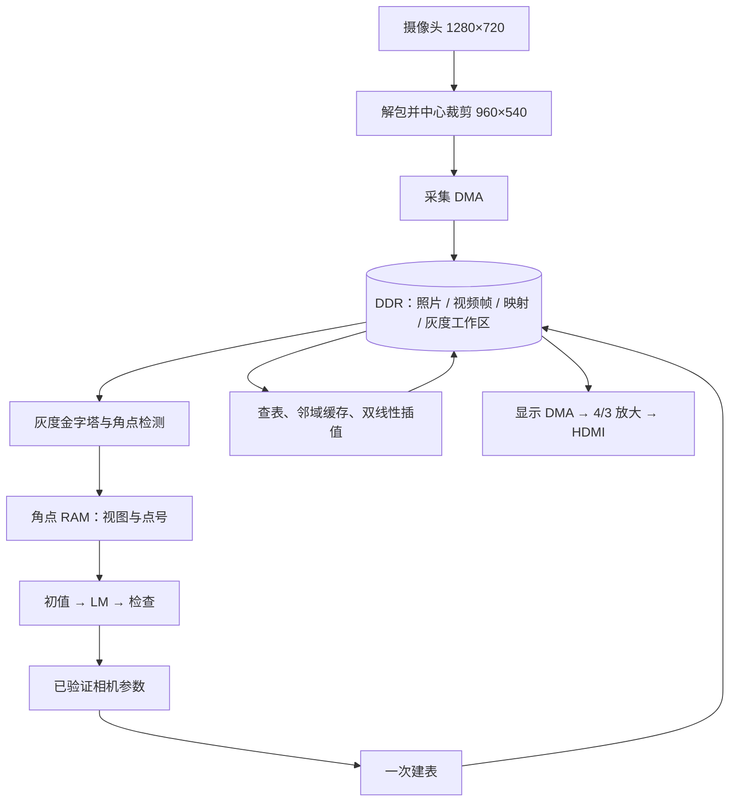

# 整体处理流程与设计架构

## 顶层与职责边界

[calibrated_view_top](../rtl/top/calibrated_view_top.v) 是板级顶层：连接相机、DDR IP、
按钮、算法时钟、视频调度、HDMI 和串口。
[vision_ddr_top](../rtl/top/vision_ddr_top.v) 是算法入口：从 DDR 原图检测角点，
求解参数，并生成校正映射。默认板级的连续像素校正由 `realtime_remap` 承担。

全部算法使用裁剪后的坐标；相机内参和角点不乘显示放大比例。
检测完成后，标定只读取角点，不再读取图像。

## 控制流程

`board_buttons` 同步并消抖按键，`video_board_flow` 管理照片槽、预览、标定、建表和视频。
上电预览；拍照或回看前先排空在途任务，照片显示两秒后返回预览。
KEY3 启动 `vision_sequence`，依次检测三张照片、收集角点、执行标定并保存参数。
KEY4 根据有效参数建一次表，然后连续校正视频；停止后返回预览。

照片槽在整个标定任务中保持稳定。视频使用另外三个原图槽和两个结果槽，
由采集、重映射和显示依次持有；只有完整成功帧能够提交显示。
视频时 DDR 读写分别仲裁，采集、校正、显示可以重叠。
标定和建表阶段停止预览并排空事务。具体状态和所有权见[实时视频](REALTIME_VIDEO.md)。

`ENABLE_DISTORT_DEMO=1` 时，`distort_demo_flow` 包装板级流程，复用同一个重映射器
完成“人工加畸变”和“独立标定后的校正”两遍处理，详见[演示设计](DISTORT_DEMO.md)。
`REALTIME_VIDEO=0` 为独立照片模式，由 `board_flow` 和逐像素校正通路完成；
这些分支由编译参数选择，不与默认视频路径同时实例化。

## 算法与共享计算

| 层次 | 控制职责 | 计算资源 |
|---|---|---|
| 检测任务程序 | 金字塔层、候选遍历、方向搜索、精修调用 | 专用窗口、响应和候选服务 |
| 检测精修微程序 | 张量求解、坐标更新、收敛量 | 共享 FP64 后端 |
| 标定程序 | DLT/Jacobi 初值、LM 差分与求解、最终检查 | 一个执行器、一份工作 RAM、共享 FP64 后端 |
| 残差服务 | 逐视图姿态与重投影残差 | 几何运算序列及共享浮点请求 |
| 数学微程序 | EXP/LOG/三角函数等内部步骤 | 定点中间值与基础算术通路 |
| 连续图像数据通路 | 缓存、查表、插值、写回 | 专用 BRAM、整数/定点流水 |

初值、LM 和检查互斥运行，阶段结束后才交出执行器和工作区。
HOST 指令暂停程序，请阶段适配器调用残差电路，暂停期间仍保留阶段所有权。
检测的多个客户端另共享 FP32 加减和距离服务，以独立响应槽隔离背压。

## 时钟与存储

| 时钟域 | 主要模块 | 交接方式 |
|---|---|---|
| 摄像头 pclk | 字节解包、裁剪、像素打包 | 双时钟 FIFO 传递描述符及 START/DATA/END |
| DDR 125 MHz | 帧调度、HMIC 仲裁、连续重映射、显示读取与放大 | 命令桥连接算法，像素 FIFO 连接显示 |
| 算法 40 MHz | 检测、标定、建表 | `vision_clock_bridge` 原子传递命令、帧描述与响应 |
| 显示 pix_clk | HDMI 时序和像素消费 | 帧首 token 对齐与欠载恢复 |
| 系统 27 MHz | 串口和独立诊断 | 带页号、年龄的跨域快照 |

完整图像和映射表存放 DDR，地址表见[根 README](../README.md#当前-ddr-分区)。
片上存储用于局部行/邻域缓存、FIFO、角点、排序工作区、程序 ROM 和标定工作 RAM。
同步 RAM 的读延迟由控制状态显式处理；复位主要清有效位及指针。

## 修改入口

| 工作内容 | 入口 |
|---|---|
| 操作顺序、帧所有权 | `rtl/control/system`、`rtl/control/demo` |
| 检测流程与算子 | `scripts/image/build_detection_program.py`、`rtl/image/features` |
| 初值、LM、检查 | `scripts/calibration/engine/build_*.py`、`data/programs/calibration` |
| 指令执行和共享计算 | `rtl/control/calibration/engine`、`rtl/compute` |
| DDR、缓存、带宽 | `rtl/memory`、`rtl/image/remap` |
| 摄像头与显示 | `rtl/video` |
| 板级连接与约束 | `rtl/top/calibrated_view_top.v`、工程 FDC |

各执行器的启动、取指和指令编码见[指令指南](INSTRUCTION_CONTROL_GUIDE.md)。
