# 基于标定计算与视频校正解耦的 FPGA 实时去畸变系统设计

## 思路来源

广角摄像头能够提供较大的视野，但镜头畸变会使直线弯曲、物体比例失真，影响观看效果与后续视觉处理。在资源受限的嵌入式平台上，去畸变面临精度、延时和硬件开销之间的矛盾：过度简化模型容易造成校正不足，逐帧执行复杂的非线性坐标计算则会增加运算负担，限制实时处理能力。

我们观察到，许多摄像头在较长时间内保持固定的镜头状态。只要光学设置与图像坐标配置稳定，即使拍摄内容不断变化，相机内参与畸变参数仍可持续复用。这意味着参数求解与视频校正具有不同的执行频率，可以采用独立的处理架构。

基于这一特点，本作品提出“按需标定、一次建表、逐帧复用”的 FPGA 去畸变方案。系统先利用棋盘图像完成角点检测与参数优化，再根据标定结果生成坐标映射。后续视频帧通过查表、坐标插值和像素采样完成校正；成像条件改变后，重新建立对应的参数与映射。

这种解耦使标定阶段能够在可接受的准备时间内进行充分优化，视频阶段则集中保障持续吞吐。在硬件上，按需执行的数值计算共享运算资源，高频像素处理采用专用流水线与缓存，减少重复计算和电路开销。通过在算法执行频率、数据表示和硬件结构三个层面协同设计，一次标定的计算投入能够持续服务于后续视频，兼顾校正精度、实时性与资源效率。

## 整体设计

我们的作品构建了一套在 FPGA 上独立完成**图像采集、相机标定、畸变校正与视频显示**的视觉系统。用户通过实时预览拍摄不同姿态的棋盘图像，启动角点检测和参数求解，随后进入连续视频校正模式，通过 HDMI 观察处理效果。上位机承担交互控制、状态查询和实验数据记录。

系统由标定路径与视频路径组成。标定路径提取图像中的几何信息，联合优化相机参数与棋盘姿态，并生成可复用的网格映射；视频路径读取映射和源图像，通过定点插值完成逐帧校正。两条路径分别围绕数值精度和持续吞吐设计，并通过参数与映射数据完成衔接。

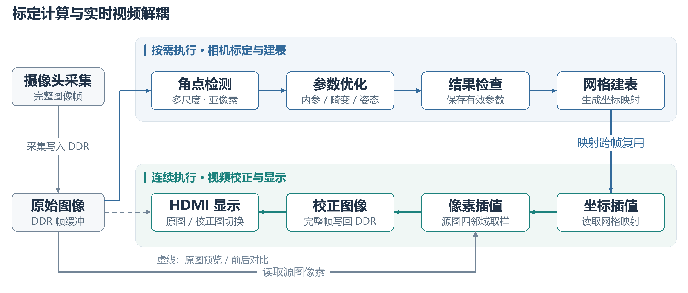

当前系统面向 **1280×720、30 帧/秒**的视频处理，采用 **5×8 个内角点**的棋盘进行标定。操作流程包括实时预览、拍摄标定照片、查看角点、求解参数和连续校正，并支持校正前后画面切换。

硬件采用共享数值核心与专用视频流水线相结合的结构。DDR 保存完整图像与映射，片上 RAM 保存程序、局部窗口和计算中间量。算法域与视频域分别运行在 40 MHz、125 MHz 时钟下，通过异步缓冲和握手完成任务交接，使数值运算、访存带宽与像素吞吐能够独立优化。

## 模块设计

系统围绕几何信息提取、相机模型求解、实时重映射和帧级存储协同划分功能。设计重点是以共享计算控制逻辑规模，以网格映射降低访存开销，以流水线和多帧缓冲维持视频吞吐。

### 1. 多尺度角点检测

角点检测采用**由粗到细的灰度金字塔**。低分辨率层用于搜索棋盘结构，获得有效网格后，将坐标逐级映射到高分辨率图像，在局部邻域中继续精修；当某一层检测失败时，可在更高分辨率层重新搜索。该策略兼顾大范围搜索与原图尺度定位，减少常规情况下的全分辨率扫描量。

单层检测包含四个步骤：

1. **候选提取。** 由图像梯度构造局部张量，计算 Harris 响应，通过非极大值抑制和相近候选合并，提取具有明显双向灰度变化的位置。
2. **结构筛选。** 在候选周围进行圆环采样，检查黑白区域交替特征，抑制普通边缘和背景纹理产生的伪角点。
3. **网格匹配。** 搜索棋盘方向，结合投影排序与行列几何关系，将离散候选组织为有序网格，建立图像角点与棋盘物理点的对应关系。
4. **亚像素精修。** 根据局部梯度求解位置增量，迭代细化坐标，并转换回原始图像坐标系，为后续标定提供亚像素观测值。

检测中的灰度金字塔和候选工作区按照片复用，各图完成后保留有序角点与检测状态。Harris 响应按需重新扫描计算，以适量重复访存换取较低的中间数据存储开销。

### 2. 多视图联合参数标定

标定模块输入棋盘的已知平面结构与有序图像角点，联合求解相机内参、畸变系数及各幅棋盘的姿态。焦距和主点描述理想成像关系，径向与切向参数描述镜头偏移，各图的旋转和平移描述拍摄角度与距离。

**多视图共享一组相机参数，各自保留独立姿态。** 所有观测共同约束同一成像模型，优化目标为最小化重投影误差：

$$
E=\sum_{i=1}^{V}\sum_{j=1}^{N}
\left\|\mathbf p_{ij}-\pi(\mathbf P_j;\boldsymbol\theta,R_i,t_i)\right\|^2
$$

其中，$\mathbf P_j$ 为棋盘物理角点，$\mathbf p_{ij}$ 为第 $i$ 幅图中的观测坐标，$\boldsymbol\theta$ 为相机内参与畸变参数，$R_i,t_i$ 为对应姿态。投影函数 $\pi$ 预测角点在图像中的位置，其与观测值之差构成优化残差。

求解分为初值构造与非线性优化两个阶段。首先进行归一化单应性估计，获得相机和姿态初值；随后采用 Levenberg–Marquardt（LM）迭代，计算残差与参数敏感度，构造带阻尼的线性方程并求取试探更新。总代价下降时接受更新，否则增大阻尼后重试。初始残差较大时，先优化内参与姿态，再逐步加入所选畸变参数，改善迭代的收敛过程。

本设计利用多视图模型的稀疏关联减少重复计算：公共相机参数影响全部视图，单幅图的姿态只影响该图残差。因此，姿态参数的数值差分、梯度和矩阵累加限定在对应视图内，试探步的接受判断仍采用全部角点的总代价，在保留联合优化目标的同时缩小局部计算范围。

主要标定运算采用双精度浮点，支持残差累加、线性方程求解与参数更新；最终以单精度发布相机参数，并在建表阶段转换为定点源坐标。高精度运算由标定阶段承担，视频通路使用适合流水处理的数据格式。

### 3. 微程序控制与共享数值计算

初值、LM 和结果检查按阶段执行，具有大量相似的矩阵、向量和浮点操作。系统将这些操作组织为微程序，通过**共享执行核心、工作 RAM 与浮点后端**完成计算，以时间复用降低硬件规模。

微程序描述运算、访存、循环、分支和服务调用。执行器从相应阶段入口取指，发起操作并等待结果，随后更新状态、推进下一条指令。矩阵和中间量保存在共享工作 RAM 中，初值、迭代与检查通过不同程序入口复用同一套主要计算资源。

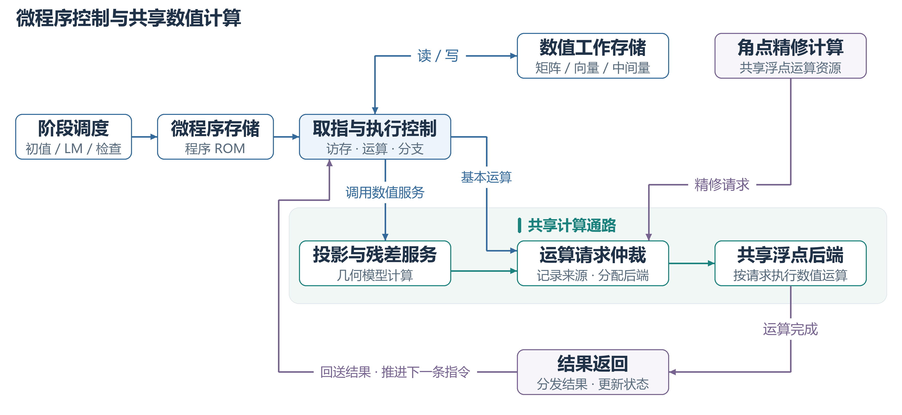

检测精修与标定通过仲裁共享浮点后端，运算请求携带来源信息，返回结果交付对应任务。矩阵维度和循环次数由程序与数据表达，中间量集中存入 RAM，从而减少重复控制逻辑、大规模寄存器阵列及组合选择网络。

共享核心采用多周期执行，适合控制复杂、允许准备时间的数值任务；像素接收、局部窗口和视频插值采用专用流水线，维持连续的数据吞吐。微程序随 FPGA 配置数据装入，运行期间由板上硬件自主执行。

### 4. 网格映射与定点视频校正

实时校正采用**输出到源图的逆向映射**。对于输出像素 $(u,v)$，先求得源坐标 $(x_s,y_s)$，再读取其四邻域像素并进行双线性插值。越界位置按边界规则填充，整个输出画面按固定顺序生成。

相机参数与输出配置确定后，坐标映射可跨视频帧复用。系统采用稀疏网格存储映射，横纵方向每隔 4 像素设置一个节点，每个节点保存两个 Q16.16 定点源坐标，网格内部位置由相邻节点插值得到。

以 1280×720 图像、每组坐标 8 字节计算：

| 映射表示          | 坐标布局                        |                    数据容量 |
| ----------------- | ------------------------------- | --------------------------: |
| 逐像素映射        | 1280×720 组坐标                | 7,372,800 字节，约 7.03 MiB |
| 间隔 4 像素的网格 | 321×181 个有效节点，含边界节点 |    464,808 字节，约 454 KiB |
| 当前行对齐布局    | 每行预留 384 个节点，共 181 行  |    556,032 字节，约 543 KiB |

当前网格布局较逐像素映射节省约 **92.5%** 的存储空间，并降低映射读取量。网格间距在坐标近似精度、存储容量和访存开销之间形成可配置的权衡。

视频通路依次完成网格预取、坐标插值、邻域取样、像素插值与结果写回。源图缓存利用相邻采样位置的空间相关性减少重复读取，上下两行数据分开组织，支持并行查找双线性插值所需的邻域像素。

像素插值采用差值形式：

$$
L(a,b,\alpha)=a+(b-a)\alpha
$$

先对上下两行分别进行水平插值，再对结果进行垂直插值，即可得到输出颜色。该形式减少互补权重乘法，中间结果保留小数精度，最终统一舍入。颜色插值采用五级流水，数据连续有效时可每周期接收一个像素任务；缓存缺失和下游等待通过背压处理，保持坐标与像素同步。

### 5. 分层存储与帧级协同

一帧 1280×720、RGB565 图像占用约 1.76 MiB。系统将完整图像和映射存入外部 DDR，片上 RAM 用于程序、角点、局部窗口、数值工作区与接口缓冲，形成面向访问特征的分层存储。

标定照片独立保留，支持回看和重复计算；灰度金字塔与候选工作区按照片复用；数值工作 RAM 在初值、迭代和检查之间复用；映射在连续视频中跨帧复用。存储容量由同时有效的数据决定，减少处理阶段之间的重复配置。

DDR 访问采用分块与突发传输。灰度转换批量读取 RGB565 像素，在模块内部完成格式转换后集中写回；实时校正优先使用源图缓存，缺失时请求 DDR 填充。访存仲裁协调采集写入、显示读取、算法访问和结果写回，并保持响应与请求的对应关系。

视频调度采用**三份原帧缓冲与两份校正帧缓冲**。原帧缓冲分别承担采集、等待和处理读取，校正缓冲交替承担结果写入与显示读取。帧数据完整写入后发布，读取完成后释放，使不同帧的采集、校正和显示能够重叠执行。

摄像头、算法、DDR 用户接口与 HDMI 工作于各自时钟域。跨域通路采用异步 FIFO 和握手传输，模块间通过背压协调速度，帧切换前完成在途事务交接，在多访问源条件下维持数据顺序与帧归属。

## 功能实现

我们的作品将图像采集、相机标定、实时校正与显示交互整合为一套可直接操作的板上系统。用户从实时预览开始，依次完成拍照、角点查看、参数计算和连续视频校正；几何校正之外，系统还提供自动亮度调节、画面旋转与串口观测，覆盖从校正模型建立到实际视频使用的完整过程。

功能设计围绕三个目标展开：**让标定操作直观可控，让校正效果便于比较，让计算过程与结果能够量化呈现。** 显示器提供画面反馈，按键完成主要流程控制，LED 指示任务状态，上位机读取参数并调整视频效果，形成相互配合的交互方式。

### 1. 实时预览与标定照片采集

标定质量与棋盘在画面中的位置、大小和倾斜角度密切相关。为便于现场调整，摄像头就绪后，系统通过 HDMI 持续输出实时预览。操作者可以一边移动棋盘，一边观察其完整性和清晰度，选择合适的姿态后直接按键拍照。

三个拍照按键分别对应三个独立照片槽位。系统接收到拍摄命令后采集完整图像，将其保存到 DDR，随后显示已保存照片约 2 秒，再自动返回实时预览。短暂停留让用户确认拍摄内容，自动返回则便于连续调整下一幅照片的姿态。照片独立保存，后续实时采集继续使用视频缓冲区，已有标定素材可以反复查看和使用。

再次按下已有照片对应的按键，可回看该照片约 2 秒。操作者能够在计算前比较各张棋盘的位置与姿态差异，LED 同步显示照片保存状态。**预览、拍摄、确认和回看构成连续的操作闭环**，使标定素材的准备过程具备明确的视觉反馈，减少依赖上位机导出图像进行检查的操作步骤。

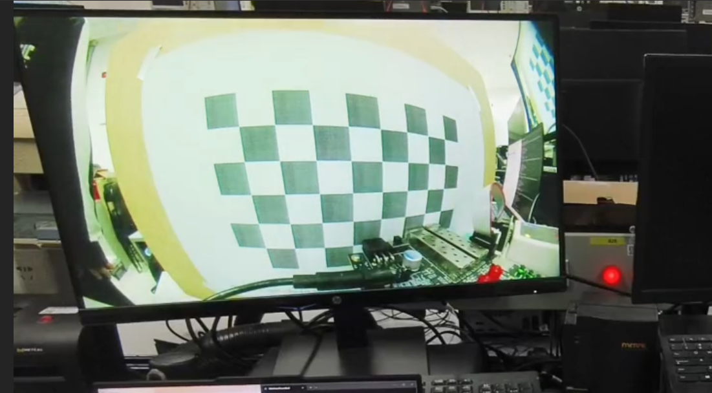

### 2. 棋盘角点检测与可视化

角点是连接图像与相机模型的几何观测值，其定位情况直接影响后续参数求解。系统完成检测后，将实际参与标定的角点以红色标记叠加到照片副本上，通过 HDMI 展示。当前 5×8 内角点配置下，每幅完整棋盘对应 40 个标记。

操作者能够逐张切换检测结果，观察标记是否落在黑白格交界处、网格是否完整、是否存在明显偏移，并在确认后进入参数求解。

**可视化与数值计算使用同一组检测结果，同时分别保存各自需要的数据精度。** 屏幕标记落在整数像素位置，标定计算保留亚像素坐标；叠加图使用独立副本，原始照片继续作为算法和效果对比的依据。这为角点定位误差与最终校正效果之间的分析提供了对应关系。

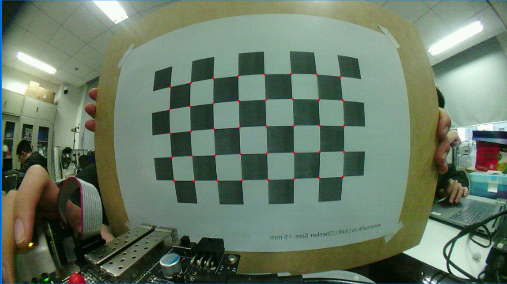

### 3. 板上自主标定与参数输出

完成标定照片采集与角点确认后，FPGA 自主执行初值求解、LM 参数迭代和结果检查，建立当前镜头对应的成像模型。输出包括水平与垂直焦距、主点位置、径向畸变系数和切向畸变系数，描述画面从理想投影到实际镜头成像的几何变化。

这一功能使设备能够根据现场采集的图像建立校正模型。更换摄像头或调整成像配置后，用户可以重新拍摄棋盘并执行标定；在相机状态稳定期间，已计算的参数持续保存在系统中，供后续建表和视频处理复用。**模型建立与视频使用分阶段进行**，将多次迭代的计算投入集中在标定阶段，支持后续持续的视频服务。

板上数值计算通过微程序调度共享浮点资源，完成多视图联合求解。参数输出同时附带重投影 RMS、收敛状态和模型信息，便于理解当前结果的拟合情况。上位机可通过串口读取并保存完整参数，进一步与 OpenCV 参考结果进行对照，使校正能力既能通过图像展示，也能通过数值结果评价。

计算过程中，系统持续提供当前阶段、视图编号和结果状态。用户可以区分正在检测棋盘、执行参数迭代、生成映射或进入视频处理等阶段，形成清晰的任务进度反馈。

### 4. 连续视频校正与前后对比

标定完成后，系统根据相机参数生成坐标映射，并进入连续视频校正。后续采集到的新帧使用已建立的映射完成取样、插值和写回，再由 HDMI 输出显示。用户可以移动棋盘或改变场景内容，观察动态画面中的校正效果，镜头模型在整个视频阶段持续复用。

视频运行期间，按键可切换原始画面与校正画面。门框、桌沿和棋盘边界等具有明显直线结构的对象，为观察桶形弯曲、边缘拉伸和几何恢复提供直观参照。切换在完整帧边界更新，系统保留标定参数与映射，使演示者能够连续比较同一场景的前后效果。

**校正前后对比保留一致的旋转、缩放与亮度增强设置**，便于将注意力集中在镜头几何校正上。几何变换和亮度增强可分别控制，既支持单独展示去畸变效果，也能展示多个图像处理功能组合后的输出。

硬件通过原帧与校正帧的多缓冲调度，让采集、处理和显示分工协作。已经完成的画面供显示读取，新的帧在其他缓冲区继续处理，完整结果再发布到显示通路。这种帧级协同配合映射复用，是系统保持连续视频输出的关键。

| 校正前                       | 校正后                       |
| ---------------------------- | ---------------------------- |
| 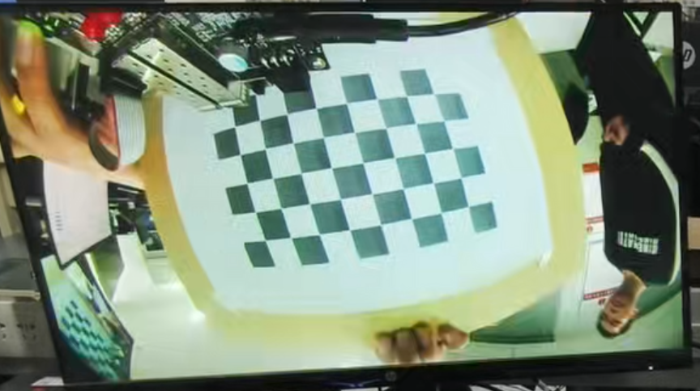 | 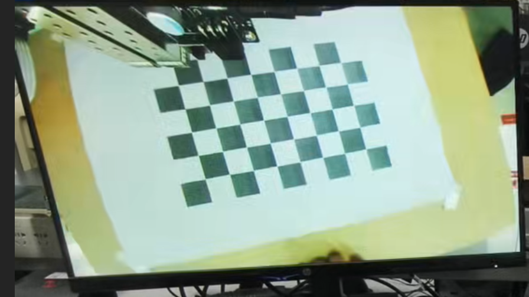 |

### 5. 自动亮度调节与图像增强

室内光照变化、背光和局部强光会改变画面的视觉层次。为提高不同照明条件下的可观看性，系统在视频输出通路中加入自适应 Gamma 调节：根据有效图像区域的亮度统计，选择提亮、保持或压暗曲线，对 RGB 像素进行非线性亮度映射。标定使用保留的原始照片，亮度增强作用于视频显示结果。

自动调节同时考虑画面内容与显示稳定性。去畸变或旋转产生的无效黑边不参与亮度统计，避免边界面积影响曲线选择；同一调节建议连续出现三个有效帧后再切换，并在单帧内锁定处理曲线，使一幅画面保持一致的亮度响应，减少场景变化时的频繁跳档。

系统还提供固定提亮、固定压暗与直方图均衡模式。固定模式便于演示不同亮度映射的效果；直方图模式统计有效像素的灰度分布，建立增强曲线，并通过与原始映射混合控制拉伸强度，改善灰度分布集中的画面层次。上位机可按场景选择合适模式。

**亮度增强采用小型查找表完成逐像素映射。** 统计和曲线更新按帧进行，像素通路复用现有视频接口，减少实时幂函数计算与大容量缓存的开销。该设计将视觉效果扩展与硬件资源控制结合起来，适合在去畸变系统中持续运行。

| 原图                    | 增强后                    |
| ----------------------- | ------------------------- |
| 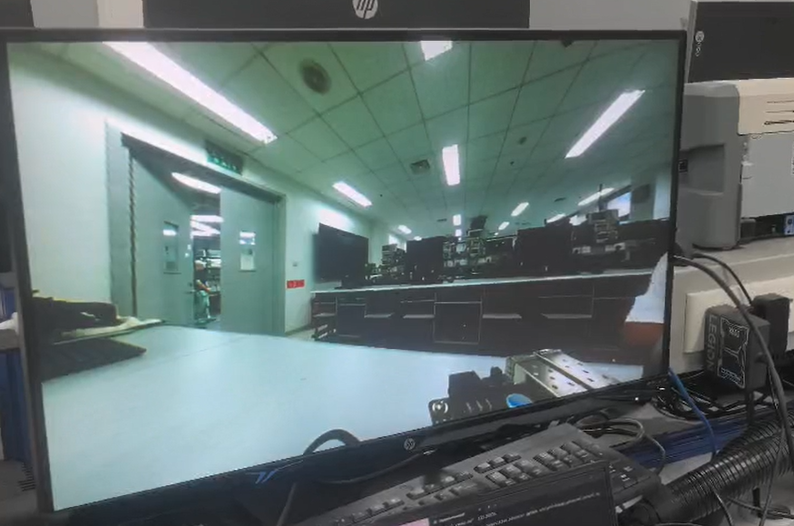 | 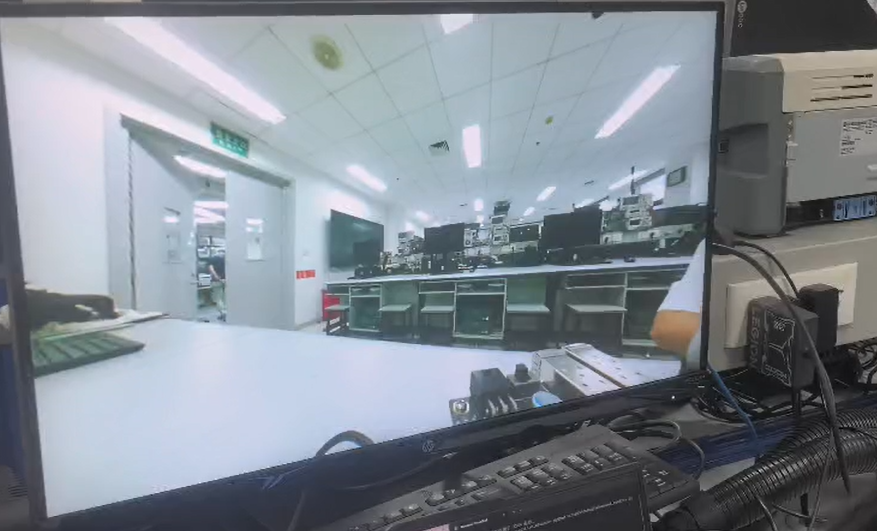 |

### 6. 上位机控制与状态观测

系统提供串口上位机接口，支持设置旋转角度、缩放比例和平移量，以及选择亮度增强模式。面对摄像头安装角度偏斜、目标位置变化或需要突出局部区域的情况，用户可以在连续视频运行中调整画面构图，直观观察配置变化对输出图像的影响。

旋转、缩放和平移统一表达为二维仿射变换。上位机将用户设置转换为少量变换系数，FPGA 接收后在帧边界应用新配置，并利用采样与插值通路生成变换后的画面。镜头标定参数继续保留，调整显示角度时可复用已有畸变映射。**通过控制参数驱动板上图像处理**，能够以较小的通信量完成动态交互。

串口还承担结果记录与运行观测：既可读取相机参数、重投影误差和角点坐标，也可查询当前任务阶段、照片有效状态、视频帧计数与异常原因。算法与视频模块的周期计数提供关键阶段耗时和单帧处理时间，上位机将这些数据整理为实验记录，便于比较不同实验条件下的精度与处理性能。

主流程由板上按键启动，显示器展示图像，LED 给出简明状态，上位机提供细粒度参数与计时信息。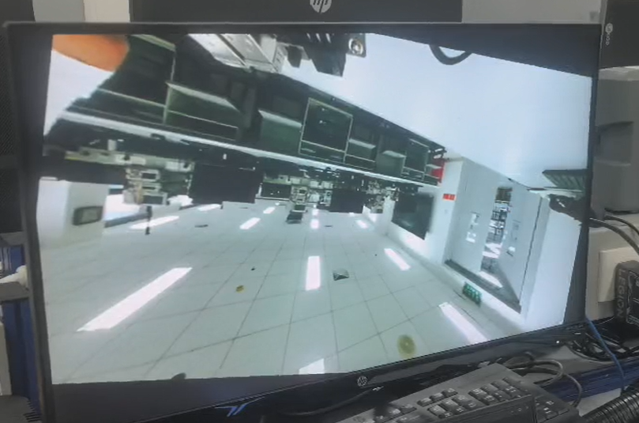

## 性能评估

性能评估采用 OpenCV 软件对照、板上运行计数和 PDS 实现报告，分别考察角点定位一致性、参数求解精度、视频处理性能及硬件资源效率。

### 1. 精度评估

**角点定位对照。** 选取一幅 1280×720 的原始棋盘图像，比较 FPGA 与 OpenCV 检测到的 40 个对应角点。统计直接使用原始像素坐标，评价该样本上的定位一致性。

| 测试样本     | 角点数 | 坐标偏差 RMS / px |   最大偏差 / px |
| ------------ | -----: | ----------------: | --------------: |
| 单幅棋盘图像 |     40 |   **1.534** | **2.687** |

**参数求解对照。** 将 FPGA 实际用于标定的 120 个角点输入 OpenCV 4.12.0，采用相同成像模型。两端求解其余相机参数与各视图姿态，以相同输入评价硬件数值计算的一致性。

重投影 RMS 定义为：

$$
\mathrm{RMS}=\sqrt{\frac{1}{VN}\sum_{i=1}^{V}\sum_{j=1}^{N}
\left\|\mathbf p_{ij}-\hat{\mathbf p}_{ij}\right\|^2}
$$

其中，$V$ 为视图数量，$N$ 为每图角点数，$\mathbf p_{ij}$ 与 $\hat{\mathbf p}_{ij}$ 分别为观测位置和模型预测位置，单位为像素。

| 参数            |           FPGA |         OpenCV |                 绝对差 |
| --------------- | -------------: | -------------: | ---------------------: |
| $f_x$ / px    |     393.617828 |     393.624740 |               0.006912 |
| $f_y$ / px    |     397.990875 |     397.997078 |               0.006203 |
| $c_x$ / px    |     605.223938 |     605.222530 |               0.001408 |
| $c_y$ / px    |     289.703064 |     289.701293 |               0.001771 |
| $k_1$         | −0.1600816101 | −0.1600851386 | $3.529\times10^{-6}$ |
| $k_2$         |   0.0165048987 |   0.0165059718 | $1.073\times10^{-6}$ |
| $p_1$         |   0.0028137101 |   0.0028144531 | $7.429\times10^{-7}$ |
| $p_2$         |   0.0029655627 |   0.0029648671 | $6.957\times10^{-7}$ |
| 重投影 RMS / px |       1.467361 |       1.467361 |       小于 $10^{-6}$ |

在本组数据上，焦距差小于 **0.007 px**，主点差小于 **0.002 px**，参与求解的畸变系数绝对差均小于 **$3.6\times10^{-6}$**。两端重投影 RMS 一致，说明采用微程序与共享运算资源的硬件实现，在相同输入与模型条件下保持了与软件参考高度一致的求解结果。

### 2. 延时与视频吞吐

测试采用 1280×720 图像，分别统计标定准备阶段的计算耗时、人工确认等待与视频启动耗时，以及映射复用后的连续视频处理能力。

**标定准备与视频启动。** 本轮测试从三张照片已拍摄完成开始计时：按下 KEY3 后，系统完成图像预处理与角点检测；角点回看确认后进入初值计算、LM 迭代与结果检查；参数发布后，按下 KEY4 启动映射建表与实时校正视频。各阶段实测结果如下。

| 阶段 | 统计范围 | 实测耗时 |
|---|---|---:|
| 三张照片预处理与检测 | 灰度转换、候选/角点检测、DDR 交接 | **4.76 s** |
| 角点回看确认 | 检测完成到确认进入标定（UI 等待，非计算） | 2.68 s |
| 初值计算（DLT/位姿） | 参数初值 | 约 0.64 s |
| LM 迭代与结果检查 | LM 开始到参数有效 | **3.63 s** |
| 初值 + LM + 检查 | 标定计算小计 | **4.28 s** |
| **算法实际计算** | **预处理与检测 + 标定计算，不含回看等待** | **约 9.0 s** |
| KEY3 → 参数发布 | 含角点回看等待 | 11.7 s |
| KEY4 → 实时视频 | 任务排空、建表、首帧准备 | **0.50 s** |

算法实际计算由图像预处理与检测、标定计算两部分组成，合计 **4.76 + 4.28 = 9.04 s，约 9.0 s**。角点回看确认的 **2.68 s** 属于人工交互等待，计入 KEY3 至参数发布的 **11.7 s**，单独列出以区分计算与操作耗时。

从 KEY3 启动到实时视频可用，扣除参数发布后等待按下 KEY4 的人工间隔，整链耗时约 **11.7 + 0.50 = 12.2 s**，其中包含本轮角点回看确认的等待时间。若同时扣除角点回看等待，自动处理与视频启动合计约 **9.04 + 0.50 = 9.54 s**。标定与建表仅在准备阶段执行，其结果可供后续视频帧持续复用。

**连续视频性能。** 独立的连续视频测试覆盖映射建立后 **112.137 s** 的稳定运行窗口，测量结果如下：

| 指标                        |                       实测结果 |
| --------------------------- | -----------------------------: |
| 图像尺寸                    |                      1280×720 |
| 新采集帧数 / 新完成校正帧数 |                  3,364 / 3,364 |
| 持续新校正帧率              |         **29.9990 帧/s** |
| 校正帧完成的平均间隔        |           **33.3344 ms** |
| 单帧处理时间抽样数          |                             12 |
| 抽样平均处理时间            |           **28.0709 ms** |
| 抽样最短 / 最长处理时间     | **28.0478 / 28.0994 ms** |
| 新增失败帧 / 跳过摄像头帧   |                **0 / 0** |

持续帧率按新增校正帧数与观察时长计算。单帧处理时间按核心时钟 125 MHz 换算，平均值及极值来自 12 个周期计数样本。

实测持续帧率接近 **30 帧/s**，抽样最长处理时间 **28.0994 ms** 低于 **33.333 ms** 的输入帧间隔，观察窗口内失败与跳帧增量均为零。标定与建表完成后，系统通过复用映射维持逐帧处理，体现了计算解耦架构的实时运行能力。

### 3. 资源用量与时序情况

**片上资源用量。** 完整图像与映射存放于外部 DDR，片上资源主要承担控制、共享计算、视频流水线与局部缓存。PDS 实现报告如下。

| 资源                   | 已用量 | 可用总量 | 占用率 |
| ---------------------- | -----: | -------: | -----: |
| 查找表 LUT             | 61,624 |   66,600 | 92.53% |
| 触发器 FF              | 54,563 |  133,200 | 40.96% |
| 块存储 DRM             |    110 |      155 | 70.97% |
| 算术单元 APM           |     71 |      240 | 29.58% |
| 分布式 RAM（报告计数） |  2,564 |   19,900 | 12.88% |
| IO                     |    148 |      300 | 49.33% |

主要资源均满足器件容量要求，LUT 余量为 4,976 个，DRM 余量为 45 个。共享运算、网格映射和分层缓存共同支撑了整套流程的板上实现。

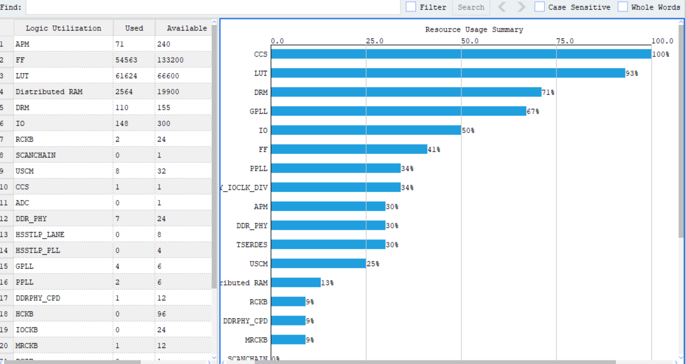

**时序情况。** 算法时钟目标为 40 MHz，DDR 用户接口与实时视频处理时钟目标为 125 MHz。

| 检查项          | 报告结果            |
| --------------- | ------------------- |
| Fmax / 时钟约束 | 1 项时钟约束未满足  |
| 慢角 Setup      | 1 条违例路径        |
| 慢角 Recovery   | 列出 197 条违例路径 |
| 慢角 Removal    | 1 条违例路径        |
| 快角 Recovery   | 列出 197 条违例路径 |
| 快角 Removal    | 1 条违例路径        |

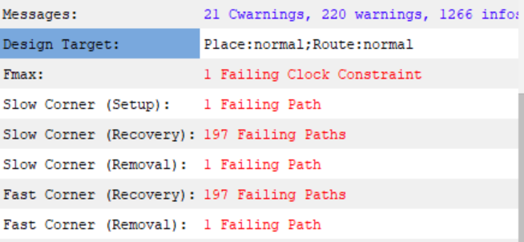

对失败路径的起点、终点和时钟域逐项分析后，可以将时序结果分为自主算法数据通路与 DDR 接口相关路径两部分。

**自主算法数据通路达到目标时钟。** `algorithm_clk` 域在慢角下的最差 Setup 裕量为 **+0.696 ns**，报告估算 Fmax 为 **41.1455 MHz**，满足 40 MHz 的设计目标；快角下的 Setup 裕量为 **+10.009 ns**。慢、快角的 Hold 汇总均无失败端点。该结果表明，在当前已施加的时序约束下，共享数值核心和算法控制的数据路径满足目标周期要求。

**剩余失败路径集中在 DDR PHY 校准与复位接口。** PHY 是 DDR 控制器中直接协调存储芯片采样、发送及初始化训练的物理接口部分，涉及多个专用时钟与复位信号。具体归属如下。

| 路径类别            | 定位结果                                               | 关键数据与含义                                                                         |
| ------------------- | ------------------------------------------------------ | -------------------------------------------------------------------------------------- |
| 慢角 Setup          | DDR PHY 内部 `calib_done` 到 DQS 门控粗校准控制      | 唯一失败路径，裕量 **−0.061 ns**；起止均位于厂商 DDR IP 层级                    |
| 慢角、快角 Recovery | DDR PHY 的复位、训练控制到数据片及专用 IO 资源的复位端 | 列出的路径终点全部位于 DDR PHY；最差裕量分别为 **−4.313 ns、−2.989 ns**        |
| 慢角、快角 Removal  | 板级上电复位计数逻辑进入 DDR PHY 复位同步器            | `cfg_clk` 到 `rst_clk` 的复位衔接路径，裕量分别为 **−1.101 ns、−0.873 ns** |

Setup 失败路径的总数据延迟为 7.298 ns，其中布线延迟占 **78.9%**，最大扇出为 327。其位置与延迟构成将优化重点指向 DDR PHY 校准控制的高扇出布线及布局。该路径承担存储接口的初始化校准控制，与棋盘角点提取、LM 参数更新和图像插值的算术路径分别属于不同功能层级。

Recovery 与 Removal 检查异步复位释放相对于接收时钟边沿的时间关系。报告中的这类失败主要分布在 DDR PHY 的复位及训练网络，其中还包含板级上电复位逻辑与 IP 同步器之间的连接。

综合路径定位与板上测试，**本作品的算法核心已满足 40 MHz 目标，连续视频具备约 30 帧/秒的实测处理能力；当前时序收敛重点位于 DDR PHY 校准、复位及板级集成。**

## 总结

我们的作品面向镜头状态相对稳定的应用场景，构建了“按需标定、一次建表、逐帧复用”的全 FPGA 去畸变系统。通过共享数值计算、稀疏网格映射与专用视频流水线，将参数求解与连续视频处理解耦，在有限片上资源内完成图像采集、相机标定、实时校正与显示。系统实测实现 1280×720、约 30 帧/秒的连续校正，同角点输入下的参数求解结果与 OpenCV 高度一致。结合角点可视化、校正前后切换、亮度自适应及上位机交互，作品将算法精度、实时处理与直观操作融为一体，展示了 FPGA 在嵌入式视觉处理中的应用价值。
