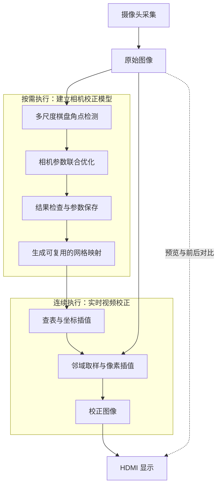
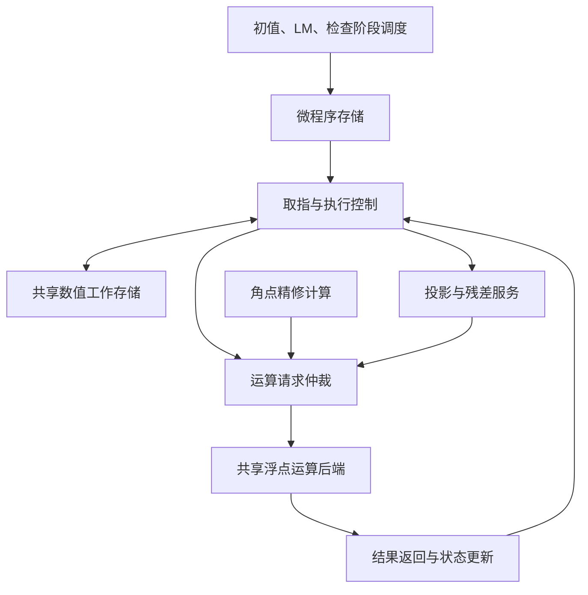
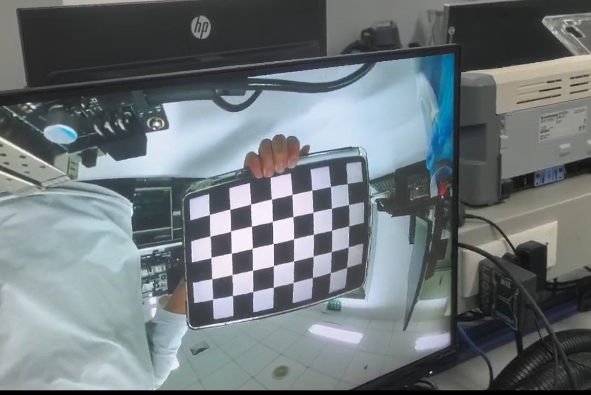
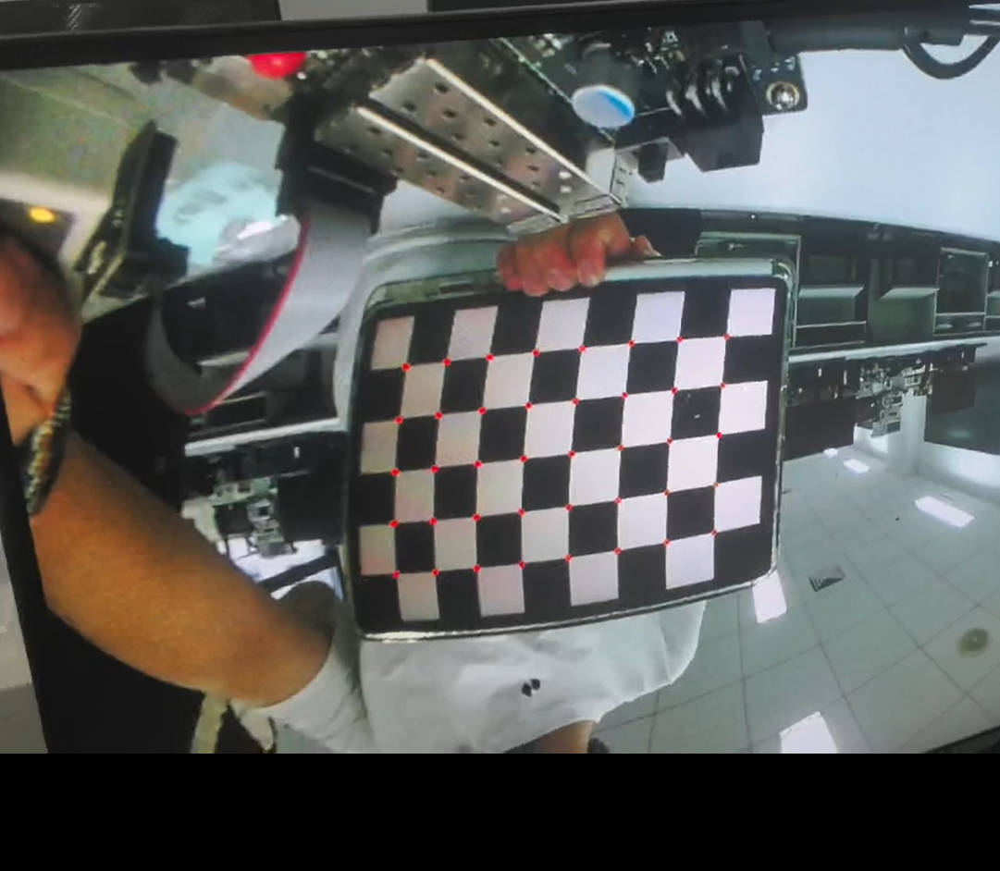
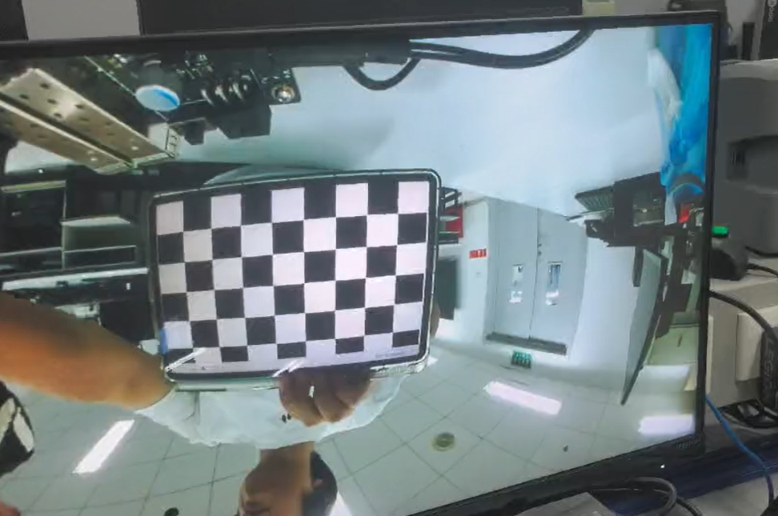
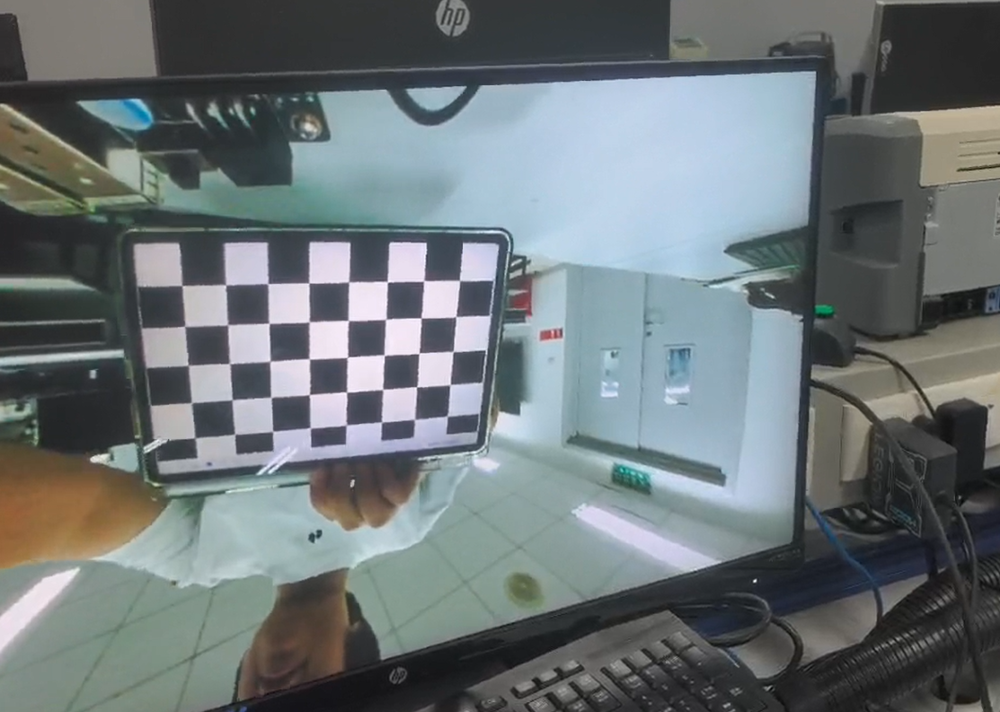
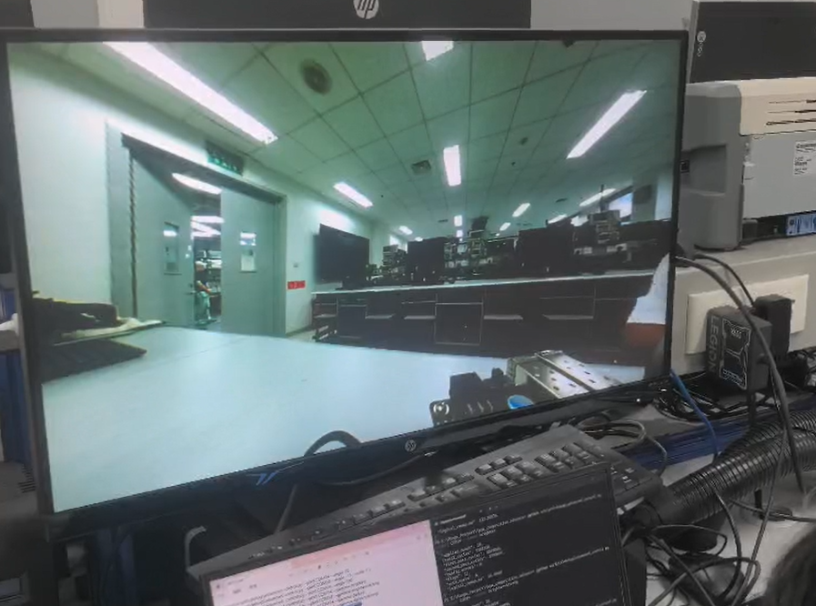
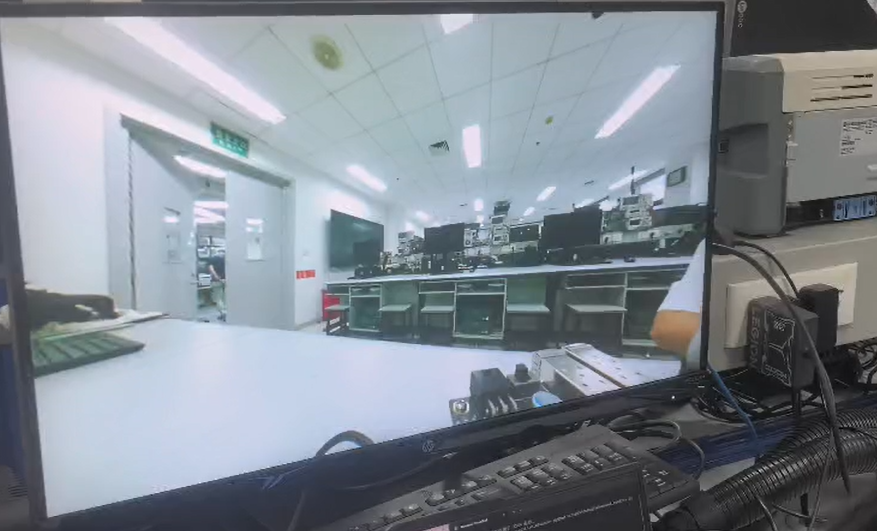
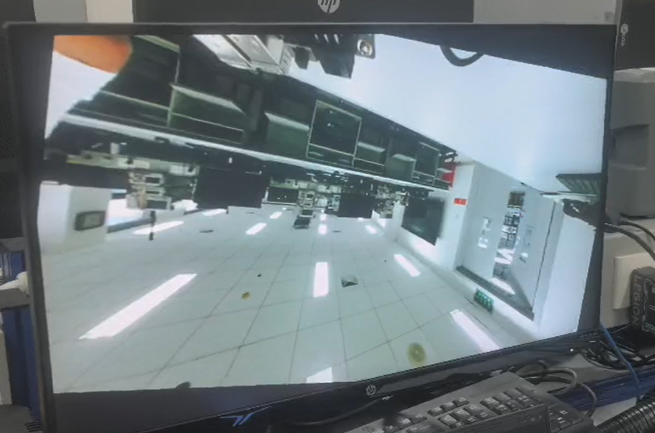

# 基于标定计算与视频校正解耦的 FPGA 实时去畸变系统设计

## 思路来源

广角摄像头能够提供较大的视野，但镜头畸变会使直线弯曲、物体比例失真，影响观看效果与后续视觉处理。在资源受限的嵌入式平台上，去畸变面临精度、延时和硬件开销之间的矛盾：过度简化模型可能导致校正不足，而逐帧执行完整的非线性坐标计算，又会增加运算负担，限制实时处理能力。

我们观察到，与频繁变焦、调焦的设备不同，许多摄像头在较长时间内保持固定的镜头状态。只要光学设置与图像坐标配置不变，即使拍摄内容不断变化，相机内参与畸变参数仍可持续复用。因此，参数求解与视频校正具有不同的执行频率，适合采用独立的处理方式。

基于这一特点，本项目提出面向 FPGA 的标定计算与视频校正解耦架构，采用“按需标定、一次建表、逐帧复用”的流程。系统先利用棋盘图像完成角点检测与参数优化，再根据标定结果生成坐标映射表。后续视频帧复用该映射，通过查表、坐标插值和像素采样完成校正；成像条件改变后，再更新相应参数与映射。

这种架构使标定阶段能够在可接受的准备时间内进行较充分的优化，视频阶段则集中保障持续吞吐。在硬件上，低频数值计算共享运算资源，高频像素处理采用专用流水线与缓存，减少重复计算和电路开销。由此，在有限资源下同时为校正精度和实时性保留空间，使一次标定的计算投入能够持续服务于后续视频。

## 整体设计

本作品构建了一套能够在 FPGA 上独立完成**图像采集、相机标定、畸变校正与视频显示**的视觉系统。用户通过按键拍摄不同姿态的棋盘图像，即可启动角点检测和参数求解；标定完成后，系统利用所得参数持续校正摄像头画面，并通过 HDMI 展示结果。上位机用于读取实验数据和辅助分析，不参与板上的标定与视频计算。

系统围绕“按需标定、持续校正”组织两条处理路径。标定路径从图像中提取几何信息，通过迭代优化获得相机参数，再生成可重复使用的坐标映射；视频路径复用该映射，对连续输入的图像执行取样与插值。通过这种分工，复杂参数求解与逐帧处理具有独立的时间预算，可以分别围绕数值精度和持续吞吐进行设计。

作品的操作过程与计算流程相对应：先通过实时预览选择棋盘位置，拍摄三张标定照片；再启动检测与标定，获得相机参数和误差指标；最后进入连续校正模式，并支持原图与校正画面的切换比较。当前设计面向 **1280×720、30 帧/秒**的视频处理目标，实验棋盘包含 **5×8 个内角点**。

硬件采用“共享数值计算与专用视频流水线相结合”的组织方式。低频、复杂的迭代任务分时使用算术资源，高频像素处理保留独立流水线；DDR 保存完整图像与映射，片上存储服务于局部计算和数据缓冲。算法与视频采用不同的时钟域，通过跨域缓冲协作，使计算复杂度、视频吞吐和片上资源可以分别优化。

## 模块设计

作品的模块划分围绕三个要求展开：从标定图像中获得可靠的几何信息，在有限硬件上完成复杂参数求解，以及将求解结果高效应用到连续视频。各模块既有独立职责，也在计算与存储资源上相互配合。下面按处理过程说明关键原理、实现方式与设计取舍。

### 1. 多尺度角点检测：兼顾搜索范围与定位精度

**检测需要同时解决“找到棋盘”和“找准角点”两个问题。** 广角画面中的棋盘大小、方向和位置会随拍摄姿态变化，背景纹理也可能产生较强的角点响应。因此，系统需要先从较大范围中筛选具有棋盘结构的候选，再对有效角点进行精确定位，为参数计算建立可靠的对应关系。

本模块采用由粗到细的灰度金字塔处理。低分辨率图像用于搜索棋盘的整体结构，找到有效网格后，将角点坐标逐级映射到更高分辨率图像中，并在局部邻域内继续精修。如果低分辨率层未能形成有效结果，则允许在更高分辨率层重新检测。这样的层级策略减少了常规情况下的全分辨率搜索量，同时保留了对较小棋盘和细节信息的处理能力。

单层检测依次完成以下工作：

1. **候选提取。** 根据图像梯度构造局部张量，计算 Harris 响应并进行非极大值抑制，提取两个方向均有明显灰度变化的位置。相近候选经过合并，减少同一角点附近的重复响应。
2. **局部结构筛选。** 在候选周围进行圆环采样，检查灰度变化是否符合棋盘黑白区域交替的特征，削弱普通边缘与部分背景纹理的干扰。
3. **整体网格匹配。** 搜索可能的棋盘方向，结合投影排序和行列几何关系，将离散候选组织为有序网格。输出点序与棋盘物理点序保持一致，使后续标定能够建立逐点对应。
4. **亚像素精修。** 利用角点附近的梯度信息求解局部位置更新，迭代细化坐标。最终坐标可落在整数像素之间，并转换回原始图像的坐标系。

检测过程也针对存储进行了取舍。Harris 响应采用重新扫描计算的方式，避免长期保存整幅响应图；灰度金字塔与候选工作区由三张照片依次复用，各图检测完成后保留有序角点和检测状态。增加少量重复扫描，可以换取较低的中间数据存储开销，而最终标定仍使用原图尺度下的亚像素结果。

### 2. 联合参数标定：利用多视图约束求解成像模型

本模块输入棋盘的已知平面结构与各幅图像中的有序角点，求解相机内参、畸变参数和棋盘姿态。焦距与主点描述理想成像关系，径向与切向参数描述镜头造成的偏移；每幅棋盘各自的旋转和平移，则解释不同拍摄角度和距离带来的投影变化。

**所有标定图像共享同一组相机参数，但具有各自的姿态。** 因而多张照片不是独立求出几套参数再取平均，而是共同约束同一个成像模型。优化目标为最小化重投影误差：

$$
E=\sum_{i=1}^{V}\sum_{j=1}^{N}
\left\|\mathbf p_{ij}-\pi(\mathbf P_j;\boldsymbol\theta,R_i,t_i)\right\|^2
$$

其中，$\mathbf P_j$ 为棋盘上的已知角点，$\mathbf p_{ij}$ 为第 $i$ 张图中检测到的坐标，$\boldsymbol\theta$ 包含焦距、主点和畸变参数，$R_i,t_i$ 为该图的棋盘姿态。投影函数 $\pi$ 根据这些量预测角点的图像位置。模型预测与实际观测之间的距离，就是优化所需降低的残差。

求解首先通过归一化单应性估计和相机初始估计，构造各图姿态及整体参数初值，随后进入 Levenberg–Marquardt（LM）迭代。每轮计算残差和参数敏感度，构造带阻尼的线性方程并求出试探更新；若全部角点的总代价下降，则接受更新，否则增大阻尼后重试。对于初始残差较大的情况，系统先优化内参与姿态，再逐步加入径向及其余所选畸变参数，使各类参数逐步参与拟合。

本设计利用多视图模型的结构减少迭代中的重复工作。改变公共内参或畸变参数时，需要重新计算所有视图；改变某一张图的姿态时，只会影响该图的投影。因此，姿态参数的数值差分、梯度和相关矩阵累加仅处理对应视图的残差范围，而最终试探步仍使用全部角点计算总代价。这一优化缩小了局部计算范围，同时保留了全局联合评价。

数值精度按阶段分配，主要标定运算采用双精度浮点，以承载累加、线性方程求解与参数更新；结果以单精度参数发布，再由建表阶段转换为视频通路使用的定点坐标。这样可将较高精度的运算开销集中在低频任务中，避免直接延伸到每一帧的像素处理。

参数发布前，系统同时检查重投影误差、收敛状态与映射有效性。局部角点拟合较好，并不必然说明图像边缘的外推合理，因此检查还需要识别映射折叠等异常。当前实现根据角点覆盖情况决定三阶径向项 $k_3$ 是否参与求解，并在相应映射异常时提供固定该项后的重试路径；所选模型与结果一并记录。这体现了高阶拟合能力与观测约束之间的取舍，便于在实验中区分模型选择和实际拟合效果。

### 3. 微程序共享计算：用时间复用控制硬件规模

初值、LM 和结果检查都涉及矩阵、向量及浮点运算。如果分别配置独立计算电路，许多算术单元只在某个阶段工作，其余时间处于空闲。本设计利用这些阶段按顺序执行的特点，将操作过程表示为微程序，由一套共享数值执行核心完成。

共享核心由程序存储、执行控制、工作存储和算术后端组成。程序记录运算、访存、循环、分支及服务调用的顺序；执行器逐条取指，发起相应操作，等待结果返回后继续推进；中间矩阵和状态保存在工作 RAM 中，供后续步骤复用。初值、迭代与检查从不同程序入口启动，但共用执行器和主要计算资源。

检测精修与标定通过仲裁复用浮点后端，各请求保留来源与响应归属，避免多个计算任务同时占用同一算术资源。矩阵维度和循环次数主要由程序及工作数据表达，降低重复展开控制逻辑的需求；阶段中间结果存入 RAM，也减少了大规模寄存器阵列及多路组合选择的压力。

共享核心采用多周期执行方式，适合循环多、控制复杂但允许一定准备时间的任务。摄像头像素接收、局部窗口、视频插值等持续工作环节则采用专用电路，按数据流推进。两种组织方式共同构成作品的计算架构：复杂数值任务通过时间复用节省资源，持续视频任务通过流水线保证处理吞吐。微程序随 FPGA 配置数据装入，运行期间由板上硬件自主执行。

### 4. 网格映射与定点校正：将成像模型转换为可复用的数据

实时校正采用从输出图像寻找源图采样位置的逆向映射。对于输出位置 $(u,v)$，系统先确定它在原始图像中的坐标 $(x_s,y_s)$，再读取该位置附近的像素并插值得到输出颜色。按输出网格组织处理，可以为每个输出位置明确安排取样；对应位置超出输入范围时，则按边界规则填充。

当相机参数和输出配置固定后，这种坐标对应关系与图像内容无关，因此可在视频运行前完成建表。本设计进一步采用稀疏网格表示：横纵方向每隔 4 像素存储一个映射节点，节点保存两个 Q16.16 定点源坐标；网格内部的逐像素坐标由相邻节点插值得到。

以 1280×720 图像、每组坐标 8 字节计算，两种表示的容量如下：

| 映射表示             | 坐标数量与布局                    | 映射数据容量                |
| -------------------- | --------------------------------- | --------------------------- |
| 逐像素保存           | 1280×720 组                      | 7,372,800 字节，约 7.03 MiB |
| 间隔 4 像素的网格    | 321×181 个有效节点，包含边界节点 | 464,808 字节，约 454 KiB    |
| 当前网格的行对齐布局 | 每行按 384 个节点、共 181 行预留  | 556,032 字节，约 543 KiB    |

按当前行对齐布局估算，映射区容量相较逐像素表示减少约 **92.5%**。网格表示减少了存储与读取负担，其代价是引入坐标插值近似；网格间距需要结合映射变化程度与误差要求选择。该容量收益来自数据表示的改变，视频处理速度还取决于源图读取和插值通路。

实时通路分为网格预取、坐标插值、邻域取样、像素插值和结果写回。前两步确定源坐标，后续像素插值根据源图四邻域计算颜色，两类插值分别处理几何位置与像素数值。源图缓存利用相邻输出点取样位置相近的特点，减少重复读取；相邻源图行分开组织，可同时查找上下两行所需的数据。

像素插值使用差值形式。例如水平方向的线性插值可写为：

$$
L(a,b,\alpha)=a+(b-a)\alpha
$$

对上下两行分别进行水平插值，再在两行结果之间进行垂直插值，即可完成双线性取样。差值形式减少了互补权重的乘法需求；中间结果保留小数精度，在最终输出时统一舍入。当前颜色插值划分为五级流水，在输入持续有效、下游可接收时能够每周期接收一个像素任务，源图缓存缺失则通过背压暂停，保持数据对应关系。

因此，复杂镜头模型主要在建表时计算，连续视频阶段执行定点查表、缓存访问和流水插值。计算被分解到不同阶段，有助于控制组合逻辑深度，并使存储优化与算术优化可以分别推进。

### 5. 分层存储与帧协同：让有限片上存储支撑连续视频

一帧 1280×720、RGB565 图像占用 1,843,200 字节，约 1.76 MiB。连续采集与显示还需要同时保留多帧，因此完整图像统一放在外部 DDR，片上存储集中服务于局部窗口、角点、数值工作区、程序和接口缓冲。

不同数据采用不同的保存方式：标定照片独立保留，便于回看与重复计算；灰度金字塔、候选点工作区按照片复用；标定工作 RAM 在初值、LM 和检查之间复用；有效映射跨视频帧复用。这样，增加处理阶段不必同步增加一套完整图像缓存，存储量主要由同时有效的数据决定。

访存以分块和突发方式组织。例如灰度转换一次读取多个 RGB565 像素，在模块内部完成格式转换后集中写回，减少逐像素请求和等待的开销。实时校正先读取映射和源图局部数据，命中缓存时直接供给插值，缺失时再请求 DDR 填充。仲裁器协调采集写入、显示读取、算法访问和校正结果写回，并将返回数据交给对应任务。

帧级调度采用三份视频原帧缓冲和两份校正帧缓冲。原帧缓冲分别容纳正在采集、等待处理或正在读取的图像；校正缓冲交替承担结果写入与显示读取。每个缓冲区都有明确的使用状态，只有完整写入后才发布，且在当前读取结束前禁止覆盖。不同帧的采集、处理与显示由此可以重叠执行，减少各环节相互等待。

算法计算采用 40 MHz 时钟，DDR 用户接口与实时校正采用 125 MHz 时钟，摄像头与 HDMI 分别位于各自像素时钟域。异步 FIFO 和握手传输承担跨域数据交换，模块间通过背压协调处理速度。控制命令与数据一起完成交接，帧切换前排空在途事务，从而在多时钟、多访问源的条件下维持数据顺序和帧归属。

## 功能实现

我们围绕“拍摄标定图像—查看检测结果—计算相机参数—观察校正效果”形成完整的操作流程，并提供亮度自适应、上位机图像变换和实验数据查询功能。操作者既可以通过显示画面直接观察处理效果，也可以结合返回的角点、参数和状态分析计算过程。

### 1. 实时预览与标定照片采集

摄像头就绪后，显示器持续呈现预览画面，便于操作者调整棋盘的位置、大小和倾斜角度。通过三个拍照按键，可以分别保存三幅不同姿态的棋盘图像；照片保存后短暂显示约 2 秒，再自动返回实时预览，方便继续拍摄下一幅。

已保存的照片支持再次回看。操作者可在启动计算前检查棋盘是否完整入画、图像是否清晰，以及三张照片是否覆盖不同位置。预览与回看共用显示设备，使标定数据准备能够直接在开发板上完成。

### 2. 棋盘角点检测与红色标记显示

启用角点查看功能后，系统先对三张照片执行棋盘检测，并在对应的照片副本上叠加红色标记。标记位置对应实际准备参与标定的最终角点，而非检测中间阶段的全部候选点。以当前 5×8 棋盘为例，每幅成功检测的图像显示 40 个角点标记。

操作者可以在三幅照片之间切换，检查红点是否准确落在棋盘内角点、是否存在遗漏或误落入背景。查看完成后，再确认进入参数求解；系统继续使用刚才检测出的同一批亚像素坐标，不重新提取角点。显示标记取整数像素位置，参数计算保留原有亚像素精度。

这一功能将角点检测结果直接呈现在图像上，使标定输入可见，也为分析后续校正效果提供依据。红色标记仅绘制在查看副本中，不改变原始照片。

### 3. 板上自主标定与计算结果输出

确认角点后，FPGA 自动完成初值求解、参数迭代和结果检查，获得焦距、主点位置及径向、切向畸变系数。求解过程由板上硬件独立执行，操作者无需在上位机上运行标定算法。

标定结果可通过串口读取，包括相机参数、重投影 RMS、收敛状态和所采用的模型信息。发生异常时，系统同时提供当前阶段与错误原因，便于区分角点检测失败、参数求解异常或结果检查未通过等情况。参数和相关状态可以保存为实验记录，与对应的标定照片一同归档。

*一次标定任务的参数输出、重投影误差与完成状态。*

### 4. 连续视频去畸变与校正前后切换

标定成功并完成映射生成后，系统进入连续视频校正模式，将新采集图像中的像素重新映射到校正后的画面，并通过 HDMI 持续显示。后续视频帧复用已有映射，无需针对每帧重新检测棋盘或计算相机参数。

显示支持在“未去畸变”和“已去畸变”之间切换。通过观察棋盘边缘、门框、桌沿等具有直线特征的物体，可以比较图像中心与边缘区域的弯曲变化。当同时启用旋转或亮度增强时，两种显示状态保持相同的附加设置，使对比主要反映镜头校正的作用。

### 5. 自动亮度调节与图像增强

系统支持基于画面亮度统计的自适应 Gamma 调节。启用自动模式后，根据有效图像区域的明暗程度选择提亮、保持或压暗曲线：较暗画面采用提亮处理，较亮画面采用压暗处理，亮度适中时保持接近原始的显示效果。

亮度统计排除映射越界形成的黑边，避免黑色填充区域影响判断；自动曲线在连续多帧呈现相同变化趋势后切换，并保持单帧内使用同一条曲线，以减少频繁调节带来的亮度跳变。该功能作用于输出图像的数字亮度映射。

除自动模式外，上位机还可选择固定提亮、固定压暗或直方图均衡等增强方式，便于在相同场景下比较不同处理效果。展示时可通过改变环境照明，观察画面由暗到亮、由亮到暗时的自适应过程。

### 6. 上位机图像变换控制与检测过程观测

上位机通过串口下发图像变换设置，支持调整旋转角度、缩放比例和平移量。FPGA 接收设置后，在完整视频帧的边界更新配置，并执行对应的二维图像变换。旋转角度的改变不需要重新估计镜头参数，可在视频运行过程中观察不同角度和显示构图。

上位机也可切换亮度增强模式，并查询当前配置是否已生效。由此，现场展示能够在保持镜头标定结果的基础上，组合演示去畸变、旋转与亮度调整等功能。

对于检测和标定过程，当前操作方式为板上按键启动，上位机查询进度、读取角点并保存计算结果。运行状态、错误原因和视频处理周期可以持续记录，用于观察任务是否正常推进，以及比较不同实验的参数与耗时。操作者可同时看到显示器上的处理效果和上位机返回的数值信息。

## 性能评估

性能评估围绕**校正精度**与**处理延时**展开。精度评价关注图像中的几何失真是否得到有效修正，以及硬件实现相对软件参考引入的误差；延时评价分别考察标定准备阶段和连续视频阶段，体现“计算一次、持续复用”的架构特点。各项实验采用统一的输入、配置和统计口径，实测结果在下列表格中补充。

### 1. 精度评估

校正效果由角点定位、参数估计和图像重映射共同决定，因此采用分阶段对照与最终效果验证相结合的方法。实验保留完整原始图像、同轮角点坐标和标定参数，统一图像尺寸、坐标原点、棋盘规格及输出视野。基础几何精度测试关闭额外的旋转和亮度增强，自然镜头与人工畸变实验分别记录。

**角点定位精度。** 在同一批原始图像上，分别使用 FPGA 检测流程与 OpenCV 棋盘检测、亚像素定位方法提取角点。统一行列编号后，计算对应角点的二维坐标差，统计均方根偏差与最大偏差，并观察中心和边缘区域的差异。软件检测结果作为对照，反映两种实现的定位一致性；同时记录完整棋盘检测的成功次数与总测试次数，评价不同拍摄姿态下的可用性。

**参数求解精度。** 将 FPGA 实际用于标定的同一组角点输入 OpenCV，采用一致的相机模型与参数自由度进行求解，再比较两者的相机参数和重投影误差。例如，当 FPGA 固定三阶径向系数时，软件对照也固定该项，避免模型不同影响判断。相同角点输入能够排除检测方法差异，使对比集中于参数求解本身。

重投影误差衡量估计模型预测的角点位置与实际观测位置之间的距离，采用如下 RMS 指标：

$$
\mathrm{RMS}=\sqrt{\frac{1}{VN}\sum_{i=1}^{V}\sum_{j=1}^{N}
\left\|\mathbf p_{ij}-\hat{\mathbf p}_{ij}\right\|^2}
$$

其中，$V$ 为标定图像数量，$N$ 为每图角点数量，$\mathbf p_{ij}$ 为输入角点，$\hat{\mathbf p}_{ij}$ 为各自求解结果重新投影得到的位置，单位均为像素。该定义按二维角点数量平均，能够直接与板上输出的 RMS 对照。参数比较记录焦距、主点和畸变系数的绝对差异，并结合投影结果解释；OpenCV 结果作为软件参考，不直接视为相机参数真值。

**重映射精度。** 固定同一组相机参数与输出配置，分别生成软件逐像素参考映射和 FPGA 网格插值映射，比较对应源坐标的均方根偏差与最大偏差。中心和边缘分别统计，以观察网格近似及定点量化在不同区域的影响。随后使用同一幅原图进行像素取样，在一致的颜色格式与边界规则下比较输出图像，进一步分析插值计算引入的差异。

**最终几何效果。** 使用未参与标定的棋盘或具有清晰直线结构的场景进行验证。对校正前后的同一组线特征分别拟合直线，统计采样点到拟合直线的均方根距离，并报告最大偏离量。将图像中心与边缘分别展示，可以判断校正是否仅改善了中心区域，以及边缘是否仍存在校正不足或过度的现象。独立图像验证与重投影误差共同评价模型的实际适用性。

| 评价项目 | 统计指标 | 实测结果 |
| --- | --- | --- |
| 角点定位一致性 | FPGA 与软件角点的 RMS 偏差、最大偏差，单位 px | 待补充 |
| 参数求解 | 同一组角点下的两组参数及各自重投影 RMS | 待补充 |
| 映射坐标误差 | 中心、边缘的 RMS 偏差与最大偏差，单位 px | 待补充 |
| 独立图像校正效果 | 校正前后直线拟合 RMS 与最大偏离量，单位 px | 待补充 |

### 2. 延时评估

系统的时间开销分为一次性的标定准备时间与连续运行时的逐帧处理时间。标定准备包括角点检测、参数求解和映射生成；映射生效后，后续视频帧仅执行重映射与像素处理。因此，这两类时间分别统计，避免将初始化开销与稳态视频性能混在一起。

**标定准备时间。** 在标定照片已保存的条件下，记录三幅图像的灰度转换与角点检测时间、初值求解时间、LM 迭代与结果检查时间，以及映射生成时间。角点查看、人工确认和按键之间的等待单独记录，不计入纯计算耗时。若某次任务发生模型重试，其实际重算时间计入该次求解总耗时，并同时标注所采用的模型和迭代情况。

对具备硬件计数的阶段，根据实际计数范围与所在时钟频率换算：

$$
T=\frac{N_{\mathrm{cycle}}}{f_{\mathrm{clk}}}
$$

其中，$N_{\mathrm{cycle}}$ 为该阶段累计周期数，$f_{\mathrm{clk}}$ 为对应时钟频率。算法域和视频域分别按各自频率计算，并注明计数的起止事件。对于目前只能通过串口状态变化观察的阶段，使用相邻采样限定开始、结束时刻，给出估计范围；上位机轮询间隔不直接作为硬件执行时间。

| 阶段 | 统计范围 | 测量结果 |
| --- | --- | --- |
| 图像预处理与检测 | 三幅照片的灰度转换、金字塔与角点检测 | 待补充 |
| 参数计算 | 初值、LM 迭代与结果检查；可观测的子阶段分别列出 | 待补充 |
| 映射生成 | 根据有效参数生成完整可用映射 | 待补充 |
| 总准备时间 | 上述计算阶段累计，不含人工查看与等待 | 待补充 |

**逐帧处理时间与持续帧率。** 映射建立并进入稳定视频运行后，连续记录多个校正帧的处理周期，统计平均值、最大值和波动范围。同时，在固定观察时长内统计成功生成的新校正帧数量，以“新帧数量 / 观察时长”计算处理帧率，并记录失败帧与跳帧情况。显示器反复显示同一帧的次数不计入新校正帧数量。

基础视频目标为 1280×720、30 帧/秒，对应平均约 33.3 ms 的新帧处理节拍。评价时结合单帧处理时间、实际新帧率和连续运行中的失败情况，判断系统能否持续跟上输入速度。旋转和亮度增强采用不同的处理组合，分别测量，避免将基础去畸变的结果直接用于代表所有功能同时开启时的性能。

**视频端到端延时。** 单帧计算时间之外，还存在采集、帧缓冲调度和显示等待。端到端延时以同一帧输入到显示输出的对应事件进行测量，并明确输入、输出的取样位置；该项需另行同步测量，不能仅由处理周期或帧率推算。这样能够同时反映系统的持续处理能力和用户观察到的画面滞后。

| 运行模式 | 单帧处理时间：平均 / 最大 | 持续新校正帧率 | 失败帧 / 跳帧 | 端到端延时 |
| --- | --- | --- | --- | --- |
| 基础去畸变 | 待补充 | 待补充 | 待补充 | 待补充 |
| 去畸变与自动亮度增强 | 待补充 | 待补充 | 待补充 | 待补充 |
| 去畸变、旋转与亮度增强 | 待补充 | 待补充 | 待补充 | 待补充 |
